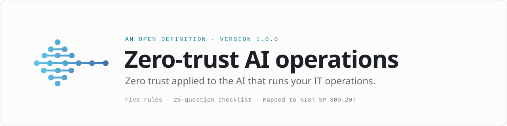
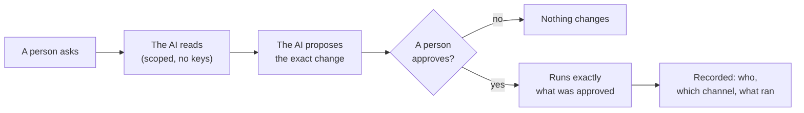

<p align="center">
  <picture>
    <source media="(prefers-color-scheme: dark)" srcset="assets/banner-dark.svg">
    
  </picture>
</p>

<p align="center">
  <a href="LICENSE"></a>
  <a href="CHANGELOG.md"></a>
  <a href="https://doi.org/10.6028/NIST.SP.800-207"></a>
  <a href="CITATION.cff"></a>
  <a href="https://gaezla.com/zero-trust-ai-operations/"></a>
</p>

**Zero-trust AI operations** is zero trust applied to the AI that runs your IT operations.

This repository holds the definition, five rules that apply the tenets of NIST SP 800-207 to an AI that operates infrastructure, and a 25-question checklist to hold any tool to them. It names no product.

## Contents

- [What is zero-trust AI operations?](#what-is-zero-trust-ai-operations)
- [The five rules](#the-five-rules)
- [How a change flows](#how-a-change-flows)
- [Use the checklist](#use-the-checklist)
- [How to cite](#how-to-cite)
- [Contributing](#contributing)
- [License](#license)

## What is zero-trust AI operations?

Zero-trust AI operations is zero trust applied to the AI that runs your IT operations. The AI gets real reach: it reads each system through its vendor's own API and drafts the fix. It gets no standing trust: its code has no network, it holds no credentials, it cannot approve, and every change waits for a person and is recorded.

Zero trust was written for people and devices. AI that investigates live systems and drafts changes is a new kind of actor: it takes instructions from whatever text it reads, and it can be wrong or talked into things. The five rules below apply the tenets of [NIST SP 800-207](https://doi.org/10.6028/NIST.SP.800-207) to that actor. Hold any tool to them, including the one you build yourself.

## The five rules

### 1. Verify every request the AI makes

Each call is authenticated and authorised for the person who asked, checked again on every call, and never trusted because it came from inside.

> **NIST SP 800-207, tenet 6:** "All resource authentication and authorization are dynamic and strictly enforced before access is allowed."

### 2. Give the AI no standing access and no keys

It gets the least it needs for one task; credentials are attached outside the model and never handed to it.

> **NIST SP 800-207, tenet 3:** "Access should also be granted with the least privileges needed to complete the task."

### 3. Assume the AI will be wrong, or talked into something

It may read and propose, but every change waits for a person, and the AI can never approve its own work.

> **NIST SP 800-207, tenet 5:** "No asset is inherently trusted."

### 4. Segment what the AI can reach

Being inside your network grants nothing: each system is reached on its own terms, and the code the AI writes gets no network at all.

> **NIST SP 800-207, tenet 2:** "Network location alone does not imply trust."

### 5. Record every decision

Who approved what, over which channel, and what ran, so you can show what the AI did and who let it.

> **NIST SP 800-207, tenet 7:** "The enterprise collects as much information as possible about the current state of assets, network infrastructure and communications and uses it to improve its security posture."

The tenets are quoted from section 2.1 of NIST Special Publication 800-207, *Zero Trust Architecture* (August 2020).

## How a change flows

Reads stay inside the asking person's scope. A change is a proposal until a person approves exactly what will run.



## Use the checklist

[CHECKLIST.md](CHECKLIST.md) turns the rules into 25 questions to ask any AI operations tool before it gets write access to production. Each question comes with a good answer and a red flag. Ask every vendor, and write the answers down.

## How to cite

GitHub's **Cite this repository** button reads [CITATION.cff](CITATION.cff). Or use:

> Tipsmark, R. (2026). *Zero-trust AI operations: definition and five rules* (Version 1.0.0). GAEZLA. <https://github.com/gaezla/zero-trust-ai-operations>

```bibtex
@misc{tipsmark2026zerotrustaioperations,
  author       = {Tipsmark, Rune},
  title        = {Zero-trust AI operations: definition and five rules},
  year         = {2026},
  version      = {1.0.0},
  publisher    = {GAEZLA},
  howpublished = {\url{https://github.com/gaezla/zero-trust-ai-operations}},
  note         = {Licensed under CC BY 4.0}
}
```

Quote the definition and the rules freely. Link to this repository or to [gaezla.com/zero-trust-ai-operations](https://gaezla.com/zero-trust-ai-operations/).

## Contributing

Corrections and proposals are welcome, with evidence. Read [CONTRIBUTING.md](CONTRIBUTING.md) first, then open an issue or start a discussion. Everyone taking part follows the [Code of Conduct](CODE_OF_CONDUCT.md).

## License

[Creative Commons Attribution 4.0 International (CC BY 4.0)](LICENSE). You may copy, adapt and republish the definition, the rules and the checklist, commercially or not, as long as you credit "GAEZLA, Zero-trust AI operations" and link to this repository or to [gaezla.com/zero-trust-ai-operations](https://gaezla.com/zero-trust-ai-operations/).

---

<p align="center">
  Maintained by <a href="https://gaezla.com/">GAEZLA</a> (T1P5M4RK, LLC) · <a href="https://gaezla.com/zero-trust-ai-operations/">gaezla.com/zero-trust-ai-operations</a>
  <br>
  <sub>GAEZLA builds an AI for IT operations around these rules. How it enforces each one, including its gaps, is on the page above.</sub>
</p>
