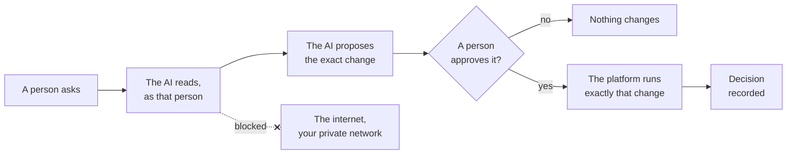

<p align="center">
  <picture>
    <source media="(prefers-color-scheme: dark)" srcset="assets/banner-dark.svg">
    
  </picture>
</p>

<p align="center">
  <a href="LICENSE"></a>
  <a href="CHANGELOG.md"></a>
  <a href="CROSSWALK.md#nist-sp-800-207-zero-trust-architecture"></a>
  <a href="CROSSWALK.md#owasp-top-10-for-llm-applications-2026"></a>
  <a href="CITATION.cff"></a>
</p>

**Zero-trust AI operations** is zero trust applied to the AI that runs your IT operations: the AI gets the reach, and never the trust.

This repository is an open, vendor-neutral specification for it: five rules, the testable requirements behind them, a conformance template, a crosswalk to NIST SP 800-207, the OWASP Top 10 lists for LLM and agentic applications and the Model Context Protocol, and a 25-question checklist for anyone buying an AI operations product.

> **Public review draft.** This is version 1.0.0-draft.1. Comments are welcome as [issues](../../issues) and [discussions](../../discussions); every comment will get a public answer before version 1.0.0 is released.

## The five rules

1. **Act only as the person who asked.** Every operation is authorised for the person who asked, by the platform, at the moment it happens. The AI has no authority of its own, and what it reads stays with the people entitled to it.
2. **Never give the AI a credential.** The platform attaches credentials to each operation outside the model. Nothing the AI can read contains a key, not even the systems it reads.
3. **Give the AI no network of its own.** The AI reaches your systems only through the platform. Its code has no network, nothing in its answers is fetched automatically, and nothing it reads can leave except to the providers you chose and through channels people control.
4. **Let only a person approve a change, exactly as it will run.** The AI can propose any change. Only a person can approve one, confirmed in a way software cannot fake, and what runs is exactly what they saw, against the same targets, before the approval expires.
5. **Record every decision where the AI cannot change it.** What the AI read, what it proposed, who approved it, how, and what ran, kept out of the AI's reach.

The [specification](SPECIFICATION.md) turns each rule into requirements with MUST and SHOULD, and ends each rule with tests anyone can run.

## Why this exists

AI that runs IT operations has to read the things operations teams read: logs, alerts, tickets, configuration, the state of every system. That means it always handles content that someone else could have written, and it always has access to sensitive systems.

Any of that content can carry instructions, and the model may follow them. This is prompt injection, and it is not solved. The OWASP Top 10 for LLM Applications 2026 states that "no reliable prevention mechanism exists today" and concludes: "Defense is therefore architectural rather than interceptive." Meta calls it "a fundamental, unsolved weakness in all LLMs".

So the honest design assumption is that the AI can be steered at any moment of any session. What a steered AI can then do depends entirely on the system around the model. NIST saw this coming. In 2020, section 5.7 of NIST SP 800-207 warned that "an attacker will be able to induce or coerce an NPE [non-person entity] to perform some task that the attacker is not privileged to perform", and called the authentication of such agents "an open issue".

Zero-trust AI operations answers it for the AI that operates infrastructure. Under the five rules, a steered AI cannot act beyond the person who asked, cannot obtain a credential, cannot send what it read anywhere but the providers you chose, cannot change a system without a person approving that exact change, and cannot erase the record. The specification also says plainly what the rules do not prevent, and requires every conformance statement to address it.

## How a change flows



The AI reads inside the asking person's permissions, through the platform. A change waits as a proposal until a person approves the exact content that will run, and confirms it with a passkey or a separate device. The platform checks the content and targets again, runs it, attaching credentials the AI never sees, and records who asked, who approved, how, and what ran. The AI has no other way in or out.

## Use it

| You are | Start with |
| --- | --- |
| Building an AI operations system, or AI into your own tooling | [SPECIFICATION.md](SPECIFICATION.md), then assess yourself with [CONFORMANCE.md](CONFORMANCE.md) |
| Buying an AI operations product | [CHECKLIST.md](CHECKLIST.md): 25 questions, with good answers, red flags and what to ask the vendor to show |
| Mapping it to frameworks you already follow | [CROSSWALK.md](CROSSWALK.md): NIST SP 800-207, the OWASP Top 10 for LLM and for Agentic Applications 2026, the Model Context Protocol, the Agents Rule of Two, the lethal trifecta, the Agentic Trust Framework and the OWASP Agent Control Standard |

## What it is not

- **Not model safety.** It does not cover hallucination, alignment, content filtering or training data. It assumes the model will misbehave and limits what that can cause.
- **Not about securing AI apps in general.** Chatbots and retrieval systems have their own guidance. This is about the AI that operates infrastructure.
- **Not a certification.** Conformance is self-assessed and published. Nobody, including the maintainers, certifies it.
- **Not a product.** It names no vendor, and any team can implement it.

## Questions

**Isn't approving every change too slow?**
Only changes wait; reads run without approval. Related proposals can be approved together with one confirmation. Work that should run unattended can be approved by a person in advance as a fixed automation, or as a class of change that people define and the platform, not the AI, applies (R4.8, R4.9). Keep proposals small and specific: OWASP notes that "approval fatigue degrades reviewer judgment at volume".

**Why a passkey for every approval? The person is already signed in.**
A sign-in proves who opened the session, not who pressed the button. AI agents now work inside people's own browsers and AI clients, with their sessions. A passkey or a confirmation on a separate device is something that software cannot supply, so it is what makes "only a person approves" true (R4.6).

**Our AI only reads. Does this apply?**
Yes. Rules 1, 2, 3 and 5 protect what it reads. A read-only AI with access to your systems and to the internet is all three legs of Simon Willison's "lethal trifecta": private data, untrusted content and a way to send data out. Rule 3 exists for exactly this case.

**Can an AI earn the right to approve changes once it has a good record?**
Not under this specification. Frameworks such as the Agentic Trust Framework let agents earn autonomy, which suits many agents. For changes to production infrastructure, one injected log line can steer a model with a perfect history, so a record earns it nothing. People decide in advance what may run unattended; the AI never does.

**Isn't prompt-injection detection enough?**
Detection lowers how often an attack works, but it cannot be relied on. OWASP, citing NIST and the UK's National Cyber Security Centre, concludes that no reliable prevention exists today. These rules limit the damage when detection fails, and no requirement can be met by a model's judgement, including a second model watching the first (R0.1).

**What does conformance not protect against?**
A person approving a harmful change they did not understand, a person acting on a wrong diagnosis, what the model provider sees, and a few others. [Section 6](SPECIFICATION.md#6-residual-risk) lists them, and every conformance statement must assess them.

**How does this relate to NIST SP 800-207?**
It applies NIST's tenets to one kind of non-person entity. The AI is the subject; authorisation and the person's approval are the policy decision; the platform's credential handling is the policy administrator; the platform's interface is the enforcement point. [CROSSWALK.md](CROSSWALK.md) has the mapping, tenet by tenet.

**How does it relate to the OWASP Top 10 for Agentic Applications?**
That list names the risks of agents in general. This specification turns the ones that matter for infrastructure into requirements a buyer can test. [CROSSWALK.md](CROSSWALK.md) maps all ten.

## Status and versioning

This is version 1.0.0-draft.1, a draft for public review. Requirements and identifiers may still change until version 1.0.0. From 1.0.0 the specification follows semantic versioning: a **patch** release clarifies wording without changing any requirement; a **minor** release adds SHOULD or MAY requirements or verification steps; a **major** release adds or changes a MUST. Requirement identifiers never change meaning within a major version. Changes are listed in [CHANGELOG.md](CHANGELOG.md).

## How to cite

GitHub's **Cite this repository** button reads [CITATION.cff](CITATION.cff). Or use:

> Tipsmark, R. (2026). *Zero-trust AI operations: specification* (Version 1.0.0-draft.1). GAEZLA. <https://github.com/gaezla/zero-trust-ai-operations>

```bibtex
@misc{tipsmark2026zerotrustaioperations,
  author       = {Tipsmark, Rune},
  title        = {Zero-trust AI operations: specification},
  year         = {2026},
  version      = {1.0.0-draft.1},
  publisher    = {GAEZLA},
  howpublished = {\url{https://github.com/gaezla/zero-trust-ai-operations}},
  note         = {Licensed under CC BY 4.0}
}
```

## Contributing

Corrections and proposals are welcome, with evidence. Read [CONTRIBUTING.md](CONTRIBUTING.md), then open an issue or start a discussion. Everyone taking part follows the [Code of Conduct](CODE_OF_CONDUCT.md).

## Licence

[Creative Commons Attribution 4.0 International (CC BY 4.0)](LICENSE). Copy, adapt and republish the specification, commercially or not, as long as you credit "Zero-trust AI operations, GAEZLA" and link to this repository.

---

<p align="center">
  Maintained by <a href="https://gaezla.com/">GAEZLA</a> (T1P5M4RK, LLC), which builds AI for IT operations.
  <br>
  <sub>The specification is vendor-neutral. GAEZLA is held to it like anyone else.</sub>
</p>
