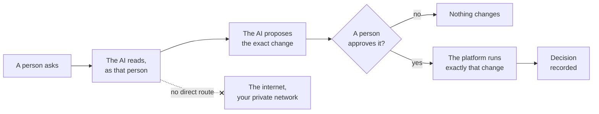

<p align="center">
  <picture>
    <source media="(prefers-color-scheme: dark)" srcset="assets/banner-dark.svg">
    
  </picture>
</p>

<p align="center">
  <a href="LICENSE"></a>
  <a href="CHANGELOG.md"></a>
  <a href="CROSSWALK.md#nist-sp-800-207-zero-trust-architecture"></a>
  <a href="CROSSWALK.md#owasp-top-10-for-llm-applications-2026"></a>
  <a href="CITATION.cff"></a>
</p>

**Zero-trust AI operations** is zero trust applied to the AI that runs your IT operations: the AI gets the reach, and never the trust.

This repository is an open, vendor-neutral specification for it: five rules, the testable requirements behind them, a conformance template, a crosswalk to NIST SP 800-207, the OWASP Top 10 lists for LLM and agentic applications and the Model Context Protocol, and a 25-question checklist for anyone buying an AI operations product.

> **Public review draft.** This is version 1.0.0-draft.1. Comments are welcome as [issues](../../issues) and [discussions](../../discussions); every comment will get a public answer before version 1.0.0 is released.

## The five rules

1. **Act only as the person who asked.** Every request is authorised for the person who asked, by the platform, when it happens. The AI has no authority of its own, and what it reads, and anything derived from it, stays with the people entitled to it.
2. **Never give the AI a credential.** The platform attaches credentials to each request outside the model, and removes from what the AI reads every credential it holds and every one it can recognise.
3. **Give the AI no network of its own.** The AI reaches your systems only through the platform. Its code has no network, and nothing in its answers is fetched or run automatically. The ways out for what it reads are the third parties you are told about, destinations whose readers may see it, and changes people approve; the specification lists the side channels that remain.
4. **Let only a person approve a change, exactly as it will run.** A person with the authority to make the change approves it, with user verification bound to that proposal. What runs is the content they saw, against the same targets, once, before the approval expires. Unattended change exists only within automations and classes that people define and bound in advance.
5. **Record every decision where the AI cannot change it.** What the AI was asked, what it read, what it proposed, who approved it, how, and what ran, kept out of the AI's reach.

The [specification](SPECIFICATION.md) turns each rule into requirements with MUST and SHOULD, ends each rule with tests a buyer can run or ask the vendor to show, and says plainly what a conforming system still does not prevent.

## Why this exists

AI that runs IT operations has to read the things operations teams read: logs, alerts, tickets, configuration, the state of every system. That means it always handles content that someone else could have written, and it always has access to sensitive systems.

Any of that content can carry instructions, and the model may follow them. This is prompt injection, and it is not solved. The OWASP Top 10 for LLM Applications 2026 states that "no reliable prevention mechanism exists today" and concludes: "Defense is therefore architectural rather than interceptive." Meta calls it "a fundamental, unsolved weakness in all LLMs".

So the honest design assumption is that the AI can be steered at any moment of any session. What a steered AI can then do depends entirely on the system around the model. NIST anticipated the risk. In 2020, writing about software agents used to administer a zero trust architecture, section 5.7 of NIST SP 800-207 warned that "an attacker will be able to induce or coerce an NPE [non-person entity] to perform some task that the attacker is not privileged to perform", and called the authentication of such agents "an open issue".

Zero-trust AI operations addresses that concern for the AI that operates infrastructure. The five rules are designed so that a steered AI cannot act beyond the authority of the people involved, cannot obtain a credential the platform holds or can recognise, cannot send what it read beyond the channels people control, cannot change a system except through a person's approval of the exact change or within limits people set in advance, and cannot erase the record. [Section 6](SPECIFICATION.md#6-residual-risk) of the specification states what remains, and every conformance statement must assess it.

## How a change flows



The AI reads inside the asking person's permissions, through the platform. A change waits as a proposal until a person with the authority to make it approves the exact content, and confirms that specific proposal with user verification, such as a passkey. The platform checks the content, the targets and the approver's permission again, runs the change once, and records who asked, who approved, how, and what ran. Code the platform runs for the change can reach only what the proposal declares, and credentials are attached by the platform, never handed to the model.

## Use it

| You are | Start with |
| --- | --- |
| Building an AI operations system, or AI into your own tooling | [SPECIFICATION.md](SPECIFICATION.md), then assess yourself with [CONFORMANCE.md](CONFORMANCE.md) |
| Buying an AI operations product | [CHECKLIST.md](CHECKLIST.md): 25 questions, with good answers, red flags and what to ask the vendor to show |
| Mapping it to frameworks you already follow | [CROSSWALK.md](CROSSWALK.md): NIST SP 800-207, the OWASP Top 10 for LLM and for Agentic Applications 2026, the Model Context Protocol, the Agents Rule of Two, the lethal trifecta, the Agentic Trust Framework and the OWASP Agent Control Standard |

## What it is not

- **Not model safety.** It does not cover hallucination, alignment, content filtering or training data. It assumes the model will misbehave and limits what that can cause.
- **Not about securing AI apps in general.** Chatbots and retrieval systems have their own guidance. This is about the AI that operates infrastructure.
- **Not a certification.** Conformance is self-assessed and published. Nobody, including the maintainers, certifies it.
- **Not a product.** It promotes no product, including the maintainer's, and any team can implement it.

## Questions

**Isn't approving every change too slow?**
Only changes wait; reads run without approval. Related proposals can be approved together with one confirmation, as long as each is shown and can be rejected on its own. Routine work can run unattended as an automation, or as a narrow class of change that people define, bound and time-limit (R4.10, R4.11). Keep proposals small and specific: OWASP (LLM01:2026, strategy 7) notes that "approval fatigue degrades reviewer judgment at volume".

**Why a passkey for every approval? The person is already signed in.**
A sign-in proves who opened the session, not who pressed the button. AI agents now work inside people's own browsers and AI clients, with their sessions. User verification bound to the specific proposal and used once cannot be completed by such software without the person's registered authenticator and the person's own gesture (R4.7). Where such software could also change what the person sees, or where an authenticator stays unlocked in the same session, confirming on a separate device that shows the proposal closes the remaining gap; the specification recommends it and lists the gap as a residual risk.

**Our AI only reads. Does this apply?**
Yes. Rules 1, 2, 3 and 5 protect what it reads. A read-only AI with access to your systems and to the internet has all three legs of Simon Willison's "lethal trifecta": private data, untrusted content and a way to send data out. Rule 3 exists for exactly this case.

**Can an AI earn the right to make changes without approval?**
Not under this specification. Some frameworks, such as the Agentic Trust Framework, let people promote an agent to act without approval of each action once it has a good record. For changes to production infrastructure, one injected log line can steer a model with a perfect history, so a record earns it nothing. People decide in advance, and within limits, what may run unattended; the AI never does.

**Isn't prompt-injection detection enough?**
Detection lowers how often an attack works, but it cannot be relied on. OWASP, citing NIST and the UK's National Cyber Security Centre, concludes that no reliable prevention exists today. These rules limit the damage when detection fails, and no requirement can be met by a model's judgement, including a second model watching the first (R0.1).

**What does conformance not protect against?**
A person approving a harmful change they did not understand, a person acting on a wrong diagnosis, what the model and search providers see, a link a person chooses to open, and a few others. [Section 6](SPECIFICATION.md#6-residual-risk) lists them, and every conformance statement must assess them.

**How does this relate to NIST SP 800-207?**
It applies NIST's tenets to one kind of non-person entity. The AI is the subject; authorisation is the policy decision, to which this specification adds a person's approval for changes; the platform's credential handling is the policy administrator; the platform's interface is the enforcement point. [CROSSWALK.md](CROSSWALK.md) has the mapping, tenet by tenet, including where the coverage is partial.

**How does it relate to the OWASP Top 10 for Agentic Applications?**
That list names the risks of agents in general. This specification turns the ones that matter for infrastructure into requirements a buyer can test. [CROSSWALK.md](CROSSWALK.md) maps all ten.

## Status and versioning

This is version 1.0.0-draft.1, a draft for public review. Requirements and identifiers may still change until version 1.0.0. From 1.0.0 the specification follows semantic versioning, as [CONTRIBUTING.md](CONTRIBUTING.md#versioning) describes: a **major** release adds, removes or changes a MUST, or a verification step that a conforming system could fail; a **minor** release adds or removes SHOULD or MAY requirements, informative text or checklist questions; a **patch** release changes wording without changing any requirement. Requirement identifiers never change meaning within a major version. Changes are listed in [CHANGELOG.md](CHANGELOG.md).

## Governance

The specification is maintained by GAEZLA, which builds AI operations software and so has an interest in this category. To keep it neutral:

- changes are proposed and decided in public issues, with the evidence for each;
- the editors named in [CITATION.cff](CITATION.cff) decide, and record each decision and its reason in the issue;
- the text promotes no product, including GAEZLA's;
- GAEZLA's own products get no exception from it;
- anyone may fork and republish it under CC BY 4.0.

## How to cite

GitHub's **Cite this repository** button reads [CITATION.cff](CITATION.cff). Or use:

> Tipsmark, R. (2026). *Zero-trust AI operations: specification* (Version 1.0.0-draft.1). GAEZLA. <https://github.com/gaezla/zero-trust-ai-operations>

```bibtex
@misc{tipsmark2026zerotrustaioperations,
  author       = {Tipsmark, Rune},
  title        = {Zero-trust AI operations: specification},
  year         = {2026},
  version      = {1.0.0-draft.1},
  publisher    = {GAEZLA},
  howpublished = {\url{https://github.com/gaezla/zero-trust-ai-operations}},
  note         = {Licensed under CC BY 4.0}
}
```

## Contributing

Corrections and proposals are welcome, with evidence. Read [CONTRIBUTING.md](CONTRIBUTING.md), then open an issue or start a discussion. Everyone taking part follows the [Code of Conduct](CODE_OF_CONDUCT.md).

## Licence

[Creative Commons Attribution 4.0 International (CC BY 4.0)](LICENSE). Copy, adapt and republish the specification, commercially or not, as long as you credit "Zero-trust AI operations, GAEZLA" and link to this repository.

---

<p align="center">
  Maintained by <a href="https://gaezla.com/">GAEZLA</a> (T1P5M4RK, LLC), which builds AI for IT operations.
  <br>
  <sub>The specification is vendor-neutral. GAEZLA is held to it like anyone else.</sub>
</p>
